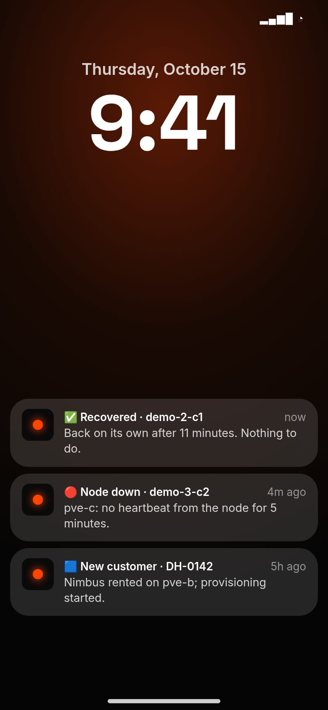
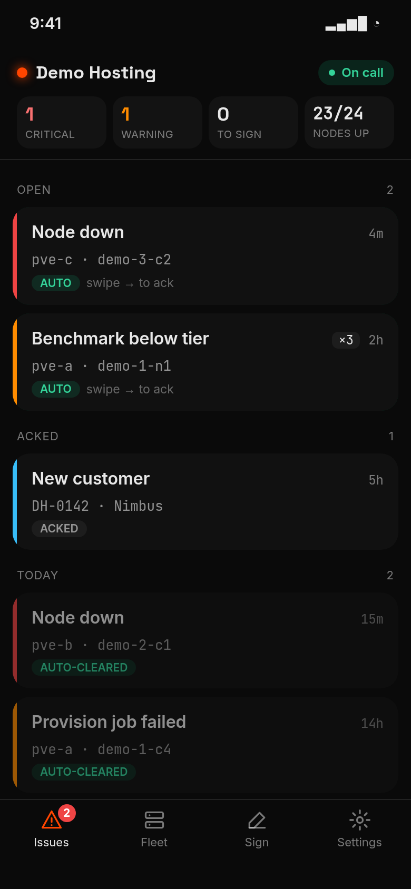
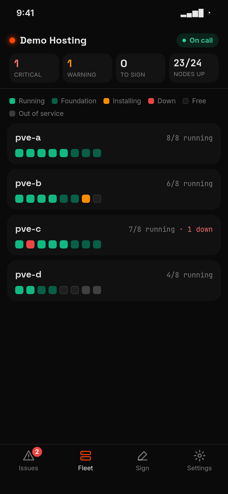
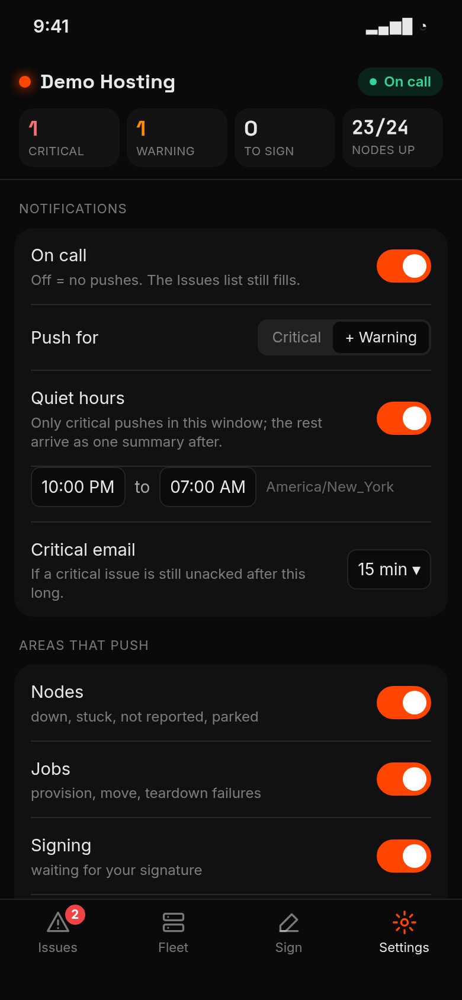

# The Flux Hub App

Your fleet on your phone: alerts become **Issues**, Issues can push to your phone, and the
whole fleet fits on one status board. It is the same for **Operators and Supporters**, on
every plan. This is the reference; [operator-onboarding.md](operator-onboarding.md) is the
path to getting your nodes live in the first place.

*Illustrative screens with sample data.*

Flux Hub turns your alerts into **Issues** and can push them to your phone. Nothing to
install on your side beyond the phone itself: the app is a web app (PWA) served by Flux Hub
at `/m`, and it pairs to your operator account from the desktop console.

## Issues — the inbox

The console's **Issues** tab (`/operator/issues`) lists what needs you now. Each Issue is
one problem, deduplicated: a repeat of the same alert bumps its count (`×3`) instead of
opening a second row. Severity is **Critical**, **Warning** (a support request is one), **Notice** (a new
customer) or **Info**; the list sorts open before acked, then by severity, newest first.

- **Ack** = "I've seen it". It stops the critical email (below) but does not close the Issue.
- Most Issues **auto-clear**: when the condition is gone (the node is back, the job
  succeeded), Flux Hub resolves it and marks it *Auto-cleared*. One marked *needs resolve*
  has no condition to watch — you **Resolve** it yourself once dealt with.
- Resolved Issues stay on the page for 24 h. The **Alerts** tab is still there: it is the
  raw feed the Issues are built from.

## Pair a phone

1. On the desktop console open the **Phone** tab (`/operator/devices`), type a device name,
   and make a pairing QR. The code is good for **5 minutes** and works once.
2. Scan it with the phone's camera and tap **Pair this phone**. The phone lands on
   **Set up this phone**, which detects the platform and walks you through:
   - **iPhone/iPad:** open the page in **Safari** (Chrome on iOS cannot install web apps) →
     Share → **Add to Home Screen** → open Flux Hub from the Home Screen. Push needs
     **iOS 16.4+** and only works in the installed app.
   - **Android:** Chrome menu ⋮ → **Install app** (or accept the install banner) → open it
     from the home screen.
   - **Desktop browser:** installing is optional (Chrome, Edge); Firefox works without it.
3. Tap **Enable notifications**, choose **Allow**, then **Send a test notification**.

If you denied the permission by mistake: Android — long-press the app icon → App info →
Notifications → Allow; desktop — the icon left of the address bar → Notifications → Allow,
then reload.

A paired device is a **read-and-ack** session: it can open `/m` and `/wall` and nothing else
on the hub. It cannot sign — the **Sign** tab shows what is waiting for your signature, and
you sign on the desktop as before.

**Revoke** a device from the Phone tab (the phone's own Settings only lists devices). To pair
the same phone again, make a new QR and repeat the steps; it picks up its notification
subscription again. A phone that says its session is gone was revoked — pair it again.

## The app

Four tabs: **Issues** (swipe a row right to Ack; tap for the detail), **Fleet** (hosts, then
each host's slots — tap a slot for its rental, status, benchmark and node lines),
**Sign** (read-only, see above) and **Settings**.

If your wallet also rents nodes, the same phone gets a fifth tab, **My nodes**, with your own
rentals and their notification settings. There is no second QR and no switching: pairing as
an operator picks up your customer side automatically.

## Notification settings

In the app's **Settings**. They apply to every device you pair, except **Mute this device**,
which silences one device (a spare phone, a wall screen).

| Setting | Default | What it does |
|---|---|---|
| **On call** | on | Off = no pushes at all. The Issues list still fills, and the critical email still runs. |
| **Push for** | Critical + Warning | Or **Critical** only. Notices (new customers) follow warnings. Info never pushes. |
| **Quiet hours** | none | Inside the window only critical pushes; everything else arrives as **one summary** when it ends. |
| **Critical email** | 15 min | 5 / 10 / 15 / 30 / 60 min — see below. |
| **Areas that push** | all | Nodes, Jobs, Signing, Inventory, Billing, Support, Other. |

How pushes behave:

- **One push per Issue**, when it opens. Repeats never push.
- More than **3** at once become **one summary** push.
- A node Issue that pushed and then cleared by itself sends **✅ Recovered**, which replaces the
  down notification on the phone.
- Critical and warning pushes are sent high-urgency so Android delivers them on an idle
  phone.

**The critical email is a floor, not a preference.** A push cannot break through Do Not
Disturb, so a **critical** Issue still open and **unacked** after the set time gets **one
email** and one re-push — whatever On call, Push for, quiet hours or areas say. It goes to
the **contact email** you gave at `/onboard`. Ack the Issue and it never fires.

> **Coming (phase 4):** today an operator alarm can reach you twice — a push *and* the
> existing alert email. The email cutover will stop alarm emails for operators with a paired,
> on-call phone (the critical email above stays), and move customer-activity emails (e.g. a
> cancelled subscription) into a **daily digest**. Emails to your customers do not change.

## The status board

The **Status** tab (`/operator/status`) is your whole fleet on one screen: hosts, slots and
open Issues. **Open the wall view** (`/wall`) for a full-screen, read-only version for a
screen on the wall — it refreshes every 30 s and says so if it stops. A wall screen pairs
exactly like a phone (Phone tab → QR); leave notifications off on it, or **Mute this device**.

## Your customers on the app

Customers who rent from you can pair a phone too, from the **Phone app** card on their
dashboard. Their guide is on the hub at [`/app`](https://fluxhub.moltentech.us/app). A
customer phone only views their own nodes: it cannot pay, configure or end a rental.

What a customer is told, by push:

- **Node down**, once one of their nodes has been down longer than their setting (default
  **15 min**; 5 / 15 / 30 / 60). The same down Issue reaches you right away.
- **Recovered**, only if they were told it was down and the node really came back. A node
  moved onto a loan, torn down, or a rental that ended sends no Recovered.
- **Billing** and **setup progress**, next to the emails they already get. Those emails do
  not change.

## Support requests

A customer asks about a node with **Get help with this node** in the app, or from **Support**
on their dashboard. The request goes to **the operator who hosts that node**: you.
Questions not about a node go to the Flux Hub team.

- A new request opens a **Support request** Issue (Warning) in your Issues list and pushes
  like any other Issue (area **Support** in Settings). The first message on a new request
  also emails your **contact email** once, so you hear about it even without a phone.
- Tap the Issue to read the thread and reply from the phone, or use **Support**
  (`/operator/support`) on the desktop console.
- Your reply pushes to the customer's phone, or emails them if they have none. The Issue
  clears when you reply or when either side closes the thread. The customer's next message
  raises it again. A closed thread stays closed; the customer starts a new request.
- **Supporters do not get support requests.** Only an operator that sells rentals does; the
  Support area is hidden otherwise.
